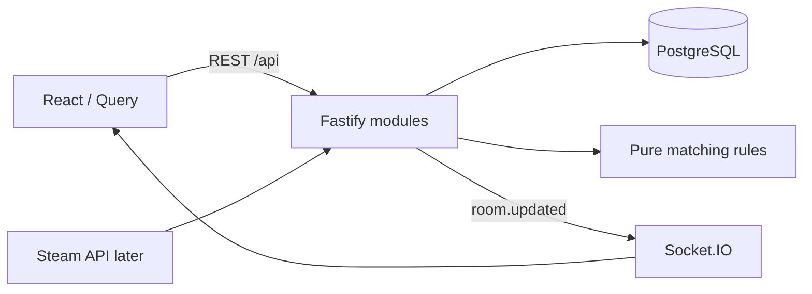

# Архитектура PartyPick

Статус: начальное решение от 4 ноября 2026 года. Можно пересматривать по результатам реализации.

## Продуктовая граница

Основной пользователь — участник постоянной компании из 2–8 друзей.
Организатор создаёт комнату, участники присоединяются по ссылке, задают условия
вечера, получают объяснимый список подходящих игр и голосуют.
Название PartyPick рабочее; доступность домена и товарного знака не проверена.

MVP: гостевой вход, комнаты, небольшой каталог, доступность игр у участников,
условия вечера, подбор, голосование, подтверждение готовности.
За пределами MVP: чат, платежи, друзья внутри сервиса, Discord-бот,
интеграции консолей, автоматическая проверка установки, машинное обучение.

## Стек и причины

| Область               | Решение                                                   | Причина                                                                               |
| --------------------- | --------------------------------------------------------- | ------------------------------------------------------------------------------------- |
| Язык                  | TypeScript strict                                         | Общий язык интерфейса и сервера, проверка границ данных                               |
| Интерфейс             | React + Vite                                              | Интерактивные комнаты, быстрый цикл разработки; SSR не требуется для приватных комнат |
| Навигация             | React Router, этап комнат                                 | Явные маршруты `/`, `/rooms/:id`, `/join/:token`                                      |
| Серверные данные в UI | TanStack Query, этап комнат                               | Загрузка, ошибки, повторные запросы и обновление кеша                                 |
| Формы и контракты     | React Hook Form + Zod, этап комнат                        | Доступные формы, проверка входных данных на клиенте и сервере                         |
| Стили                 | CSS Modules + CSS variables, этап интерфейса комнат       | Изоляция стилей и собственная система компонентов                                     |
| API                   | Node.js + Fastify, REST                                   | Явные HTTP-команды, валидация, тесты без сетевого порта                               |
| База                  | PostgreSQL + Drizzle, этап хранения                       | Связи, ограничения, транзакции и SQL-миграции в Git                                   |
| Realtime              | Socket.IO, этап совместной комнаты                        | Уведомления об изменениях; восстановление состояния через REST                        |
| Тесты                 | Vitest; Testing Library и Playwright по мере появления UI | Правила подбора, поведение интерфейса, сценарий нескольких участников                 |
| Репозиторий           | npm workspaces                                            | Общие контракты и доменные правила без отдельной публикации пакетов                   |
| CI                    | GitHub Actions                                            | Форматирование, типы, тесты и сборка на push/PR                                       |

В каркасе установлены React, Vite, Fastify, TypeScript, Vitest и Prettier.
Остальные выбранные библиотеки подключаются на соответствующем этапе.
Точные разрешённые версии установленных пакетов фиксирует package-lock.json.

## Структура

```text
apps/
  web/src/          # React + FSD: app/, pages/, shared/; остальные слои по необходимости
  api/src/          # Fastify; далее modules/, db/, plugins/
packages/          # появятся contracts/ и matching/ при первой общей реализации
docs/              # архитектура, этапы, решения
.github/workflows/ # CI
```

Frontend следует [FSD](frontend-fsd.md). Сервер — модульный монолит. Модули: sessions, rooms, catalog, matching, voting.
Каждый содержит маршруты, сценарии и запросы к хранилищу, когда они понадобятся.
Не добавляем универсальный repository слой до появления конкретной потребности.
`packages/matching` — чистые функции без React, SQL и HTTP.
`packages/contracts` — Zod-схемы публичных запросов, ответов и событий;
внутренние строки БД не являются API-контрактом.



## Данные

- guest_sessions: id, hash секретного токена, created_at, expires_at.
- rooms: id, host_member_id, status, version, created_at, expires_at.
- invites: room_id, hash токена, expires_at, revoked_at.
- members: id, room_id, session_id, display_name, joined_at.
- games: id, name, min/max игроков, поддерживаемые режимы, ориентир времени сессии.
- member_games: member_id, game_id, ownership, installed (yes/no/unknown).
- preferences: member_id, доступное время, желательные режимы, запрет покупки/установки.
- game_responses: member_id, game_id, preference (want/okay/veto).
- votes: room_id, round, member_id, game_id.
- confirmations: room_id, round, member_id, confirmed_at.

Foreign keys и уникальные ограничения защищают от повторного вступления и голосования.
Временные интервалы храним в UTC; отображаем в часовом поясе участника.
Максимум игроков в каталоге относится к конкретному поддерживаемому режиму,
если у разных режимов разные ограничения. Длительность — оценка, не гарантия.
Список игр и источник характеристик проверяем вручную для начального каталога.

## Правила подбора

1. Применить обязательные ограничения: число игроков, доступность игры,
   запрет покупки/установки, исключения участников, пересечение времени.
2. Не трактовать неизвестную доступность как подтверждённую: показать, что требуется уточнение.
3. Допустимые игры ранжировать по предпочтениям, сначала по худшей оценке
   участника, затем по сумме оценок; равенство разрешать стабильным ID.
4. Возвращать reason codes и параметры, а не готовый текст из бизнес-логики.
   Интерфейс переводит причины в понятные сообщения.
5. При пустом результате показать причины исключения. Не ослаблять обязательные
   ограничения и не исключать участника автоматически.

Конкретные веса и поведение при неполных ответах фиксируются примерами и тестами
на этапе matching. При финализации все участники должны завершить ответы.

## API и совместное состояние

Планируемые команды: создать комнату; вступить; получить снимок; изменить свои
условия; получить подбор; проголосовать; завершить голосование; подтвердить готовность.
Проверка сессии, членства и роли проводится сервером на каждой команде.
Состояния: collecting → voting → confirmed → closed.
Изменение состава или ограничений после начала голосования сбрасывает результат
и начинает новый раунд; интерфейс явно сообщает об этом.

База — источник истины. После успешной транзакции сервер отправляет
`room.updated { roomId, version }` только авторизованным участникам этой комнаты.
Клиент повторно получает снимок REST; после reconnect также загружает снимок.
Socket.IO по умолчанию не гарантирует доставку пропущенных событий.
Периодический refetch активной комнаты покрывает потерю уведомления без reconnect.
Результат голосования и номер раунда фиксируются транзакцией; повторная запись
голоса обновляет существующий голос. Конфликт версии возвращает 409.

## Гостевой доступ

Ник не является удостоверением личности. Для гостя сервер выдаёт случайный
секрет в HttpOnly cookie (Secure в production, SameSite=Lax), в БД хранится hash.
Приглашение разрешает вступление, но не доступ к чужой сессии или правам хоста.
Для изменяющих запросов проверяем Origin; клиент и API работают на одном origin.
Для комнат и приглашений задаём срок жизни; токены не попадают в логи.
На создание/вступление/голосование добавляем лимиты запросов и размера входных данных.
В MVP нет восстановления гостя после удаления cookie; предупреждаем об этом в UI.

## Размещение

Начальная цель: один экземпляр API, PostgreSQL, статический интерфейс,
единый HTTPS origin через reverse proxy (`/api`, `/socket.io`).
Провайдера и бюджет выберем перед публикацией. Redis и несколько экземпляров
API понадобятся только при подтверждённой необходимости масштабирования.
Миграции запускаются явно при выпуске; секреты хранятся вне репозитория.
